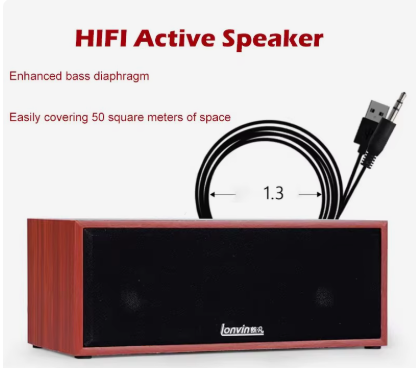

# yoRadio.vs

Platformio клоны Arduino сборки [ёРадио](https://github.com/e2002/yoradio/?ysclid=mvw0c4k7jv370463529) Releases v0.9.693    
esp32 wrover e n8r8    
[pinout ESP32-DevKitC V4](https://docs.espressif.com/projects/esp-dev-kits/en/latest/esp32/esp32-devkitc/user_guide.html#overview)

esp32 s3 n16r8    
[chip and lcd from GOOUUU-Tech-ESP32-S3-CAM-Expansion-Board](https://github.com/profharris/GOOUUU-Tech-ESP32-S3-CAM-Expansion-Board/blob/main/README.md)    
[pinout ESP32-S3-DevKitC-1 v1.1](https://docs.espressif.com/projects/esp-dev-kits/en/latest/esp32s3/esp32-s3-devkitc-1/user_guide_v1.0.html)

Железо в каталоге \hardware    
Комментарии   
- Корпус   
  
- Платы разработки
  
 

