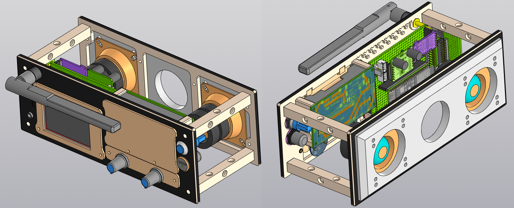

# yoRadio.vs
первая версия    
![v1]/hardware/release_v1.png)

вторая версия

Platformio клоны Arduino сборки [ёРадио](https://github.com/e2002/yoradio/?ysclid=mvw0c4k7jv370463529) Releases v0.9.693    
esp32 wrover e n8r8    
[pinout ESP32-DevKitC V4](https://docs.espressif.com/projects/esp-dev-kits/en/latest/esp32/esp32-devkitc/user_guide.html#overview)

esp32 s3 n16r8    
[chip and lcd from GOOUUU-Tech-ESP32-S3-CAM-Expansion-Board](https://github.com/profharris/GOOUUU-Tech-ESP32-S3-CAM-Expansion-Board/blob/main/README.md)    
[pinout ESP32-S3-DevKitC-1 v1.1](https://docs.espressif.com/projects/esp-dev-kits/en/latest/esp32s3/esp32-s3-devkitc-1/user_guide_v1.0.html)

Железо в каталоге \hardware    
Комментарии   
- Корпус - саундбар на шнурке (усилок NS4248 без диф входа, громкость на переменнике 50к) дерево (реально mdf 5mm) Sunbuck LONVIN 80x80x215 динамики 2х10w 4ohm (реально 6w) - выкидываем все кроме динамиков (это фронтт), печатаем морду на 3D принтере со всеми интерфейсами (это бэк)    
- Платы разработки в проекте с чипами esp32 wrover i r8n8 и [esp32 s3 alt1 n16r8 из набора](https://github.com/profharris/GOOUUU-Tech-ESP32-S3-CAM-Expansion-Board) 
- Монитор ILI9341 без тач или с [тач из набора](https://github.com/profharris/GOOUUU-Tech-ESP32-S3-CAM-Expansion-Board) - но на тач пинов не хватит, кстати отличаются по посадке - с тач  pcb короче
- Энкодеры - Питание - вместо 5v - подаем 3.3v иначе входы esp32 сгорят
- Модуль-адаптер JETTING Micro SD SPI или SDIO 3В
- Модуль приемника ИК-датчиков TZT KY-022 или набор с пультом TENSTAR ROBOT HX1838

аудио тракт
- ЦАП pcm5102A - не забыть запаять перемычки и закоротить SCK (этот вывод не используем) Питание 5v
- с ЦАП идем не внешний разъем маму мини джек и обратно возвращаем сигнал на усилитель
- усилитель с диф входом HT8698 имеет один управляющий вход CTRL - через 1 ком притягиваем его на землю - mute, обратно включаем программно через pin esp32    
*вся аналоговая земля = выход ЦАП + джек + вход усилка (левая и правая аудио земля соединены чтобы через трехпиновый разъем пройти) - НЕ ДОЛЖНА быть закорочена на цифровую землю - пойдет помеха (она уже закорочена разработчиком в модуле ЦАПА по схеме звезды - дополнителльно паять НЕ НУЖНО!!!), выход усилка со своей аналоговой левой и правой землей чисто на динамики*

упс 2S
- два аккумулятора 18650
- Модуль зарядного устройства для литиевых батарей 18650 2S
- Модуль Литиевая плата защиты BMS 2S 20A 7,4В 8,4В 18650
- Кнопка On/Off Модуль Регулятор напряжения TZT XL-10AH      
*Кнопка дублируеттся внешней кнопкой (замыкание на землю) с подсветкой без фиксации (Momentary Self-reset) + светодиоод на 3V-6V(5V)*
- Модуль преобразователя напряжения occkic 3.6-32В в 5/9/12В 5А      
*В файле ups_PCB.zip доки на схему и сборку*
- Модуль индикации заряда батареи diymore 1S-4S или Индикатор емкости батареи diymore Battery Capacity Indicator 2S (на две банки) 

вход
- Ставим шнурок Type-C 6pin для быстрой зарядки и передачи данных usb 3.1 (DongLiLian USB-C4P6P водонепроницаемый разъем TYPE C2P) - это 6 проводов (vcc gnd d+ d- cc1 cc2) 6pinFemaly с одной стороны на корпус и с другой стороны разъем 6pinMale     
*из шнурка два вывода d+ d- убираем от выхода 6pinMale и припаиваем их к переходнику 4pinMale*
*разъем 6pinMale внутри корпуса втыкаем в зарядник (vcc gnd cc1 cc2), а 4pinMale в плату ESP32 (d+ d-)*
*таким образом через один внешний разъем Type-C мы можем подключить или быструю зарядку или кабель для прошивки* 

схему собираем по распиновке для выбранной платы     
для wrover /config/myoptions_wrover.h
для s3 alt /config/myoptions_s3_alt.h

софт   
для wrover используем окружение        
default_envs = esp32-wrover-kit из файла /config/env/config_DevBoard_ESP32_Wrover-kit.ini    
для s3 alt используем окружение    
default_envs = esp32-s3-devkitc-1-alt из файла /config/env/config_DevBoard_ESP32-S3-DevKitC-1-ALT.ini    

правки оригинала v0.9.693      
- добавлен выбор конфигурации в зависимости от используемой платы     
*/src/core/options.h*    
- добавлен пин управлени mute - переменная #define AMP_MUTE_GPIO    
*в /src/main.cpp отключаем mute (ставим 1) усилка после подключения к wifi*    
- добавлено ограничение громкости при сохранении диапазона энкодера 255 - переменная - #define MAX_VOL 190    
*переписана функция /src/core/pllayer.cpp функция - volToI2S*    
- расширено количество wifi сетей с 5ти до 10    
*/src/core/config.h neworkItem ssids[10];*    
*/src/core/config.cpp функция - Config::initNetwork*    
*/data/www/options.html.gz добавлено в разметку +5 полей для wifi*    
- в вебморду добавлен блок будильника (типа спящий режим)- но пока не работает, не знаю как..., просто нарисовал
*/data/www/options.html.gz*    

