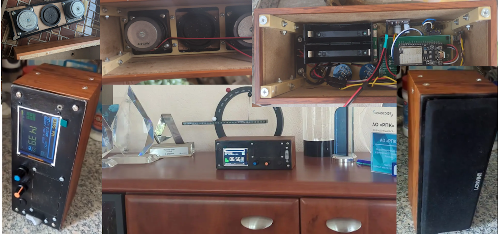
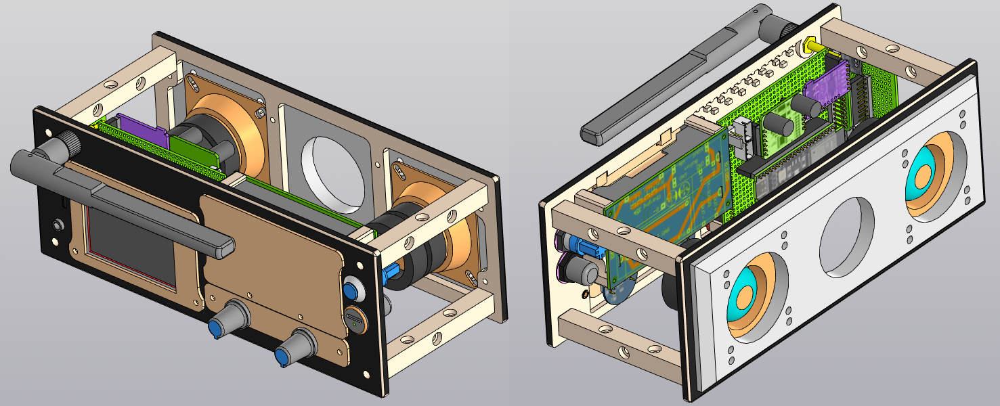
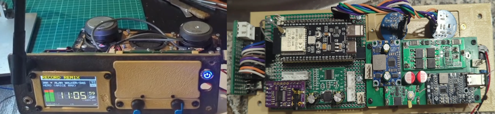

# git_yoRadio_Wrover_S3
> Platformio клоны Arduino сборки [ёРадио](https://github.com/e2002/yoradio/?ysclid=mvw0c4k7jv370463529) Releases v0.9.693  

авторы:
* **Серега Соколов** - все четко и продуманно - вся схемотехнка, выбор компонентов, софта, 3d печать, пайка, логика идеи, правильные слова и огромная поддержка!!!
* **Александр Зайцев** - чисто по: -порисовать, поболтать, помоделировать, попрограммировать, попаять - не вдаваясь особенно в детали 
* **Алиса Ай** - реинжиниринг/хакинг - наш чел! полностью перелопатила исходный проект Arduino ёРадио, помогла перенести его на VSCode Platformio, нашла все глюки, испонила все хотелки, подключила SD в режиме SDIO (я и слов то таких не знаю) - короче без нее - наш проект появился бы на пару лет позже!!! Супер - пока бесплатна!

## первая версия на врувере    
(esp32 wrover e n8r8, дисплей ILI9341 86мм, 2x энкодера, ЦАП pcm5102A, усилок HT8698)  
platformio.ini
```
default_envs = esp32-wrover-kit
;default_envs = esp32-s3-kit
;default_envs = esp32-s3-devkitc-1-alt
```
config/myoptions_wrover.h
```
//SDC_CS ;SDCARD — не используется в этой сборке (SDC_CS закомментирован).
``` 
    
https://github.com/user-attachments/assets/2cd889ca-598d-4703-a9b4-8989fbc78619
    
xls pinout (/hardware/youradio Wrover_S3-pinout.xlsx)    
    
[pinout ESP32-DevKitC V4](https://docs.espressif.com/projects/esp-dev-kits/en/latest/esp32/esp32-devkitc/user_guide.html#overview)
    

## вторая версия на альтернативной s3    
(esp32 s3 alt1 n16r8,дисплей ILI9341 81мм, 2x энкодера, ЦАП pcm5102A, micro SD SDIO, усилок HT8698)  
platformio.ini
```
;default_envs = esp32-wrover-kit
;default_envs = esp32-s3-kit
default_envs = esp32-s3-devkitc-1-alt
```
config/myoptions_s3_alt.h
```
// SDC_CS: реального CS в SDIO нет, но значение !=255 нужно, чтобы
// включилась компиляция USE_SD. Ставим заведомо несуществующий GPIO 49 —
// пин никуда не подключается и ни с чем не конфликтует.
#define SDC_CS      49
```
    
    
https://github.com/user-attachments/assets/9a0339bc-2b3c-4589-a19d-a416dd21c862        
    
xls pinout (/hardware/youradio Wrover_S3-pinout.xlsx)    

[chip and lcd from GOOUUU-Tech-ESP32-S3-CAM-Expansion-Board](https://github.com/profharris/GOOUUU-Tech-ESP32-S3-CAM-Expansion-Board/blob/main/README.md)    
[pinout ESP32-S3-DevKitC-1 v1.1](https://docs.espressif.com/projects/esp-dev-kits/en/latest/esp32s3/esp32-s3-devkitc-1/user_guide_v1.0.html)


## третья версия на классической s3    
(дисплей ST7735S, 2x энкодера, ЦАП pcm5102A, micro SD SDIO, усилок HT8698)  
platformio.ini
```
;default_envs = esp32-wrover-kit
default_envs = esp32-s3-kit
;default_envs = esp32-s3-devkitc-1-alt
```
config/myoptions_s3.h
```
// SDC_CS: реального CS в SDIO нет, но значение !=255 нужно, чтобы
// включилась компиляция USE_SD. Ставим заведомо несуществующий GPIO 49 —
// пин никуда не подключается и ни с чем не конфликтует.
#define SDC_CS      49
```    

xls pinout (/hardware/youradio Wrover_S3-pinout.xlsx)    


Прошивка    
---
- выбираем нужный конфиг в platformio.ini
- в теминале vscode\platformio
```
pio run --target clean   # сбросить кеш
pio run                  # пересобрать
pio run -t upload        # Загрузка кода
pio run -t uploadfs      # Вебморда - Загрузка файлов в SPIFFS
pio run -t monitor       # Монитор порта
```
- подключаемся к wifi login 'yoRadioAP' password 12345987
- в браузере открываем страницу [192.168.4.1](http://192.168.4.1/) пишем доступ к своей wifi сети WPA2 (2.4Ггц)
- в браузере открываем страницу с ip на экране монитора девайса

Железо в каталоге \hardware    
---
- Корпус - саундбар на шнурке (усилок NS4248 без диф входа, громкость на переменнике 50к) дерево (реально mdf 5mm) Sunbuck LONVIN 80x80x215 динамики 2х10w 4ohm (реально 6w) - выкидываем все кроме динамиков (это фронтт), печатаем морду (/hardware/kompas_3d/box_compas.zip) на 3D принтере со всеми интерфейсами (это бэк)    
*дальше просто меняем морды и начинку в рамках одного корпуса (в первой версии UPS был штатный на TZT Type-C 15Вт 3А во второй уже модерн!!! плюс внешняя аненна - т.к. в тестовой эксплуатации на югах не удавалось отойти долеко от передатчика wifi)*    
- Платы разработки в проекте с чипами esp32 wrover i r8n8 и [esp32 s3 alt1 n16r8 из набора](https://github.com/profharris/GOOUUU-Tech-ESP32-S3-CAM-Expansion-Board) 
- Монитор ILI9341 без тач или с [тач из набора](https://github.com/profharris/GOOUUU-Tech-ESP32-S3-CAM-Expansion-Board) - но на тач пинов не хватит, кстати отличаются по посадке - с тач  pcb короче
- Энкодеры - Питание - вместо 5v - подаем 3.3v иначе входы esp32 сгорят
- Модуль-адаптер JETTING Micro SD SPI или SDIO 3В
- Модуль приемника ИК-датчиков TZT KY-022 или набор с пультом TENSTAR ROBOT HX1838

Аудио тракт
---
- ЦАП pcm5102A - не забыть запаять перемычки и закоротить SCK (этот вывод не используем) Питание 5v
- с ЦАП идем не внешний разъем маму мини джек и обратно возвращаем сигнал на усилитель
- усилитель с диф входом HT8698 имеет один управляющий вход CTRL - через 1 ком притягиваем его на землю - mute, обратно включаем программно через pin esp32    
*вся аналоговая земля = выход ЦАП + джек + вход усилка (левая и правая аудио земля соединены между собой  чтобы через трехпиновый аудио разъем пройти) - <ins>аналоговая земля НЕ ДОЛЖНА быть закорочена на цифровую</ins> - пойдет помеха (она уже и так закорочена разработчиком в модуле ЦАПА по схеме звезды в нужном месте по разводке pcb - дополнителльно паять НЕ НУЖНО!!!), выход усилка со своей аналоговой левой и правой землей чисто на динамики*

UPS 2S 
---
- два аккумулятора 18650
- Модуль зарядного устройства для литиевых батарей 18650 2S
- Модуль Литиевая плата защиты BMS 2S 20A 7,4В 8,4В 18650
- Кнопка On/Off Модуль Регулятор напряжения TZT XL-10AH      
*Кнопка дублируеттся внешней кнопкой (замыкание на землю) с подсветкой без фиксации (Momentary Self-reset) + светодиоод на 3V-6V(5V)*
- Модуль преобразователя напряжения occkic 3.6-32В в 5/9/12В 5А      
*В файле ups_PCB.zip доки на схему и сборку*
- Модуль индикации заряда батареи diymore 1S-4S или Индикатор емкости батареи diymore Battery Capacity Indicator 2S (на две банки) 

Type-C на морде
---

- Ставим шнурок Type-C 6pin для быстрой зарядки и передачи данных usb 3.1 (DongLiLian USB-C4P6P водонепроницаемый разъем TYPE C2P) - это 6 проводов (vcc gnd d+ d- cc1 cc2) 6pinFemaly с одной стороны на корпус и с другой стороны разъем 6pinMale     
*из шнурка два вывода d+ d- убираем от выхода 6pinMale и припаиваем их к переходнику 4pinMale*
*разъем 6pinMale внутри корпуса втыкаем в зарядник (vcc gnd cc1 cc2), а 4pinMale в плату ESP32 (d+ d-)*
*таким образом через один внешний разъем Type-C мы можем подключить или быструю зарядку или кабель для прошивки* 

схему собираем по распиновке для выбранной платы         
* для wrover /config/myoptions_wrover.h     
* для s3 alt /config/myoptions_s3_alt.h     

Soft   
---

* для wrover используем окружение        
default_envs = esp32-wrover-kit из файла /config/env/config_DevBoard_ESP32_Wrover-kit.ini    
* для s3 alt используем окружение    
default_envs = esp32-s3-devkitc-1-alt из файла /config/env/config_DevBoard_ESP32-S3-DevKitC-1-ALT.ini    

Reengineering base release yoradio v0.9.693      
---
> [!NOTE]
версия v1.0.0 (релиз)

- добавлен выбор конфигурации в зависимости от используемой платы     
   - [x] /src/core/options.h    
- /config/myoptions_wrover.h и /config/myoptions_s3_alt.h добавлена переменная #define AMP_MUTE_GPIO (пин управлени mute)    
   - [x] в /src/main.cpp отключаем mute (ставим 1) усилка после подключения к wifi    
- добавлено ограничение громкости volToI2S() + MAX_VOL ограничение громкости (чтобы динамики не «пожечь» по ВЧ)
при сохранении диапазона энкодера 0..254: значение ручки размазывается на диапазон 0..MAX_VOL с учётом per-station offset (config.station.ovol). Звук физически не превышает MAX_VOL, ручка визуально доходит до конца. Альтернатива (жёсткое отсечение map(..., 0, 254)) задокументирована в комментарии к функции
   - [x] /config/myoptions_wrover.h и /config/myoptions_s3_alt.h добавлена переменная MAX_VOL 190    
   - [x] ~~/config/myoptions_wrover.h и /config/myoptions_s3_alt.h добавлена переменная VOL_WARN_ZONE 20 зона плавного изменения цвета~~    
   - [x] /src/core/player.cpp переписана функция - uint8_t Player::volToI2S(uint8_t volume)  
- добавлено отображение превышения громкости (индикация выхода за лимит MAX_VOL: полоса и цифры в диалоге — сырые данные 0..255 (ручка), число внизу — фактическое значение на ЦАПе (volToI2S). Цвет числа и цифр плавно подкрашивается VOL_OVER_COLOR: t = 0 до лимита, далее линейно до 255 при ручке 254)  
   - [x] /src/displays/widgets/widgets.h в классе Widgets добавлена функция setFgColor(uint16_t color) (RGB565, пропорция 0..255)
   - [x] /src/core/display.cpp добавлена структура для плавной генерации цвета static uint16_t blendColor(uint16_t c1, uint16_t c2, uint16_t t)
   - [x] /src/core/display.cpp переписана функция - Display::_volume()
   - [x] /config/myoptions_wrover.h и /config/myoptions_s3_alt.h добавлена переменная цвета превышенния ограничения VOL_OVER_COLOR    
- расширено количество wifi сетей с 5ти до 10    
   - [x] /src/core/config.h neworkItem ssids[10];    
   - [x] /src/core/config.cpp функция - Config::initNetwork    
   - [x] /data/www/options.html.gz добавлено в разметку +5 полей для wifi    
- в вебморду добавлен блок будильника (типа спящий режим)- но пока не работает, не знаю как..., просто нарисовал
   - [x] /data/www/options.html.gz*
    
---    
> [!NOTE]
текущая сборка
- в конфигурацию /config/myoptions_s3_alt.h включена поддержка SD карты в режиме SDIO ((короткие провода). SDC_CS = 49 — фиктивный (реального CS в SDIO нет, !=255 нужен для компиляции USE_SD).)       
   - [x] /src/core/sdmanager.h заменен целиком
   - [x] /src/core/sdmanager.cpp изменены инклюды и функции bool SDManager::start() void SDManager::stop() bool SDManager::cardPresent();
   - [x] /src/core/config.cpp отключен блок #if defined(SD_SPIPINS) || SD_HSPI (автостарт SDSPI закомментирован; SD поднимается лениво, по обращению)
   - [x] /src/core/options.h — SD_HSPI отключён (#ifndef SD_HSPI закомментирован)
- Страховка пропущенного PSTART на старте с SD - фикс при старте с sd не рисовался VU Meter (слишком быстрый старт) (на холодном старте с SD плеер играет раньше, чем строится экран: событие PSTART теряется, VU оставался залочен. Фикс: в _start() VU лочится
только если он выключен в настройках ИЛИ плеер ещё не играет; в loop() — однократная страховка (плеер играет, VU залочен -> принудительная раскладка). WEB-режим не затронут.)  
   - [x] /src/core/display.cpp строки 311, 327, 471
- переписан функционал mute усилителя (плагин ampmute) (мьют внешнего усилителя (HT8698, вход CTRL) по состоянию плеера;
снятие мьюта (ставим 1) после подключения к WiFi (Config::initNetwork). Инициализация в setup() ДО ветвления AP-режима — работает и в AP;
loop() в главном цикле. Пин — AMP_MUTE_GPIO.)    
   - [x] добавлены файлы /src/core/ampmute.h и /src/core/ampmute.cpp
   - [x] добавлены файлы /src/main.cpp — init до AP-ветвления, loop()   
- гашение встроенного RGB-LED на GPIO48 (S3)(светодиод WS2812 на плате S3 защёлкивал наводки с «висящего» пина. Было: neopixelWrite(48,0,0,0). Стало: rgbLedWrite(48,0,0,0) + pinMode(48, OUTPUT) + digitalWrite(48, LOW) — нулевой кадр и удержание линии в LOW. Для Wrover-ветки — пусто (WS2812 на плате нет).)
   - [x] /src/main.cpp
- добавление дескриптора wifi сети ( (label) + расширение до 10 сетей, wifi.csv получил третью колонку — дескриптор сети. Переписан
parseSsid (трёхколоночный, с параметром по умолчанию — старые вызовы работают), initNetwork читает и сохраняет label, добавлена labelBySsid() (без дескриптора — сам SSID). Дескриптор показывается на бут-экране (BOOTSTRING) и в _swichMode вместо «сырого» SSID. Список сетей расширен с 5 до 10 (neworkItem ssids[10]); в вебморду добавлено +5 полей (options.html.gz, script.js.gz: handleWiFiData, submitWiFi); кеш имён wifi/плейлиста в chunkedHtmlPage отключён — имена сохраняются
в wifi.csv/playlist.csv во флеш-памяти.)
   - [x] /src/core/config.h в struct neworkItem добавлен дескриптор
   - [x] /src/core/config.h изменена сигнатура bool parseSsid
   - [x] /src/core/config.cpp замена реализации bool Config::parseSsid 
   - [x] /src/core/config.cpp изменена функция 
   bool Config::initNetwork() 
   - [x] /src/core/netserver.cpp изменена функция void handleIndex(AsyncWebServerRequest * request)
   - [x] /src/core/netserver.h в переменную extern добавлен блок (<div><label for="label">label:</label><input type="text" id="label" name="ssid" value="" maxlength="15" autocomplete="off" placeholder="Короткое имя"></div>)
   - [x] /src/core/network.cpp изменена функция bool MyNetwork::wifiBegin(bool silent)
   - [x] /src/core/network.cpp изменена функция void MyNetwork::WiFiLostConnection(WiFiEvent_t event, WiFiEventInfo_t info)
   - [x] /data/www/script.js.gz изменена функция function handleWiFiData(fileData)
   - [x] /data/www/script.js.gz изменена функция function submitWiFi()
   - [x] /data/www/options.html.gz добавлено 10 блоков <input type="text" id="label0" maxlength="15" placeholder="Короткое имя" />
   - [x] /src/core/netserver.cpp изменена функция void NetServer::chunkedHtmlPage кеш на имена wifi сетей и плейлист отключаем (имена wifi при редактировании теперь сохраняются в файле wifi.csv playlist.csv на флеш памяти)  
- отображение дескриптора wifi сети вместо имени
   - [x] /src/core/config.h расширен class Config {
   - [x] /src/core/config.cpp добавлена константа const char* Config::labelBySsid(const char* ssid){
   - [x] /src/core/display.cpp исправлена заглушка void Display::_swichMode(displayMode_e newmode) {
   - [x] /src/core/display.cpp исправлена обработка case BOOTSTRING
- показать инфо экран в браузере команда http://<ip-радио>/?dspinfo=1  
   - [x] /src/core/commandhandler.cpp в конце exec
   - [x] /src/core/display.h расширен private class Display на uint32_t _infoShown = 0;
   - [x] /src/core/display.cpp дополнена функция void Display::loop() 
- рисуем свою страницу инфо (вместо диалога при входе в INFO — отдельная страница: дескриптор сети крупно, ниже колонкой SSID, IP, RSSI (дБм), свободная память. Автовозврат в плеер через 10 секунд. Расширение pages[] до 5 страниц (_buildPager, _swichMode). Веб-экран dspinfo по команде ?dspinfo=1 — добавлен в commandhandler)
   - [x] /src/core/common.h добавляем enum pages_e
   - [x] /src/core/display.h расширен private class Display на FillWidget и TextWidget 
   - [x] /src/core/display.cpp Page *pages[] расширяем на 5ть страниц + страница INFO
   - [x] /src/core/display.cpp Page *pages[] меняем _buildPager(), _swichMode(), loop()
   - [x] /src/core/commandhandler.cpp — exec, браузер = ip вашей вебморды + параметр ?dspinfo=1

- переход на версию ядра 3 (espressif32@~8.0.0)(обновление фреймворка платформы в platformio.ini)
   - [x] platformio.ini

---
> [!NOTE]
прочее, подготовка к переезду на новое железо и остановк работ по релизу main

<!-- ======= даты «XX» и «(ранняя)» уточняются по git log --date=short;
     в каждую запись «Что» можно дописать «Коммит: a1b2c3d» ======= -->
### 2026-11-22 — Фикс бут-петли в SD-режиме + чистый откат PR_CHECKSD
**Что:** бут с сохранённым SD падал в петлю рестартов (RTC_SW_CPU_RST через
~100 мс после SD indexing, детерминированно). Причина: `audioroute::begin()`
при расхождении `play_mode` с маршрутом звал `changeMode(PM_WEB)`, а штатный
`changeMode` при `network.status==SDREADY` делает `ESP.restart()` — Wi-Fi ещё
не был поднят (поднимается фоновой задачей `searchWiFi`). Теперь режим
выравнивается только при `CONNECTED`, иначе источник подгоняется под
фактический `play_mode` с сохранением в конфиг. Заодно из `PR_CHECKSD` убран
дублирующий `PR_PLAY` — `changeMode` сам отправляет его (плеер ещё числится
запущенным, `pir == true`), было двойное «Connect to new host» при откате.
Откат дополнен проверкой `network.status==CONNECTED`
(+ `#include "network.h"` в player.cpp).
**Изменённые файлы:**
- src/core/audioroute.cpp — ветка выравнивания в begin(), инклюд network.h
- src/core/player.cpp — PR_CHECKSD: чистый откат, проверка сети, чистка мёртвого кода
**Проверено:**
- бут с сохранённым SD — `Ready in SD Mode!`, играет без рестарта, Wi-Fi в фоне;
- выдёргивание карты на ходу — откат за ~0.5 сек, ОДИН коннект, радио играет;
- бут в радио-режиме — штатный, без регрессий.

### Этап 2 — Пин-обмен: DIN ↔ IR (СДЕЛАНО, подтверждено тестами)
**Что:** I2S DIN перенесён с GPIO17 на GPIO8, IR-приёмник — с GPIO8 на GPIO18.
Резерв DIN — GPIO17 (освободился). GPIO45 рассмотрен и отклонён:
стрэппинг VDD_SPI, риск на каждом холодном старте.
**Проверено (два уровня):**
  - изолированный тест (tests/01_i2s_duplex/duplex_tone): счётчик ровный,
    реакция на замыкание DIN(8)→GND — поток вырождается в нули;
  - основной yoRadio: [RX] 882688 байт/5с (расчётные 882000), замыкание
    DIN(8)→GND — ненулевых: 0 при живом байтовом счётчике.
**Изменённые файлы:** config/myoptions_s3.h (I2S_DIN 8, IR_PIN 18),
tests/01_i2s_duplex/duplex_tone/src/main.cpp

## маршрутизатор аудио (audioroute) — этап: сшивка TODO(2)(4)

Что сделано:
- `src/core/audioroute.cpp` — вместо заглушек:
  доступность SD = `sdman.ready && sdman.cardPresent()`;
  единая точка останова `stopCurrent()` по идиоме `resetPlayer()` (resetQueue + PR_STOP + разовый loop);
  запуск источника через `changeMode()` + `PR_PLAY(config.lastStation())`
- `src/core/audioroute.h` — добавлен `onSourceLost()`: откат источника на RADIO при пропаже карты
- `src/core/player.cpp` — `PR_CHECKSD` теперь синхронизирует маршрут: без этого конфиг оставался бы «SD» при мёртвой карте
- `src/main.cpp` — `audioroute::begin()` после `config.initPlaylistMode()`, до smartstart: маршрут восстанавливается из конфига, недоступный источник откатывается
- TODO(3) — хук сохранён (реализуется на dual core), TODO(5) — валидация BT-комбинаций (dual core)

### Поведение при старте (важно — это отклонение от штатной логики yoRadio)
- сеть поднимается в фоне: при сохранённом источнике SD `network.begin()`
  ставит статус `SDREADY` и запускает Wi-Fi задачей `searchWiFi` на core 0;
- выравнивание режима плеера с маршрутом выполняется ТОЛЬКО при
  `network.status == CONNECTED`. При `SDREADY` источник подгоняется под
  фактический режим (`play_mode`), `changeMode()` не вызывается.
  Причина: штатный `config.cpp::changeMode()` при переходе на PM_WEB
  в состоянии SDREADY делает `ESP.restart()` («смена режима без сети →
  рестарт») — вызов из бута давал детерминированную петлю перезагрузок
  (RTC_SW_CPU_RST после SD indexing, 3 из 3 бутов);
- запуск воспроизведения из конфига остаётся за smartstart.

### Откат при потере SD (PR_CHECKSD)
Периодическая проверка карты в player.cpp. При PM_SDCARD и
`!sdman.cardPresent()` и `network.status == CONNECTED`:
1. `sdman.stop()` — останов декодера;
2. `audioroute::onSourceLost()` — маршрут в конфиге откатывается на RADIO;
3. `config.changeMode(PM_WEB)` — он САМ отправит PR_PLAY (плеер ещё
   числится запущенным, `pir == true`); отдельный PR_PLAY не нужен —
   иначе двойное соединение с хостом;
4. `netserver.requestOnChange(MODE, 0)` — уведомление вебморды.

Проверка сети перед откатом обязательна: без неё откат в первые секунды
после бута (пока searchWiFi не поднял Wi-Fi) снова упирается в рестарт
из config.cpp. При отсутствии сети откат просто перенесётся на следующий
тик (2 сек).

### Известные ограничения
- BT-источник и BT_A2DP-потребитель — этап dual core
  (`srcAllowed`/`sinkAllowed` всегда false);
- `Player::initHeaders` — чтение тегов ID3 до старта не реализовано
  (заглушка `|| true`).

Тесты:
- бут с дефолтным маршрутом (RADIO) — поведение не изменилось
- выдёргивание карты на ходу в PM_SDCARD — `PR_CHECKSD` откатывает на радио,
  конфиг перезаписывается, ОДИН коннект с хостом
- бут с сохранённым SD — `Ready in SD Mode!`, без рестарта, Wi-Fi в фоне,
  smartstart играет SD; перезагрузка в радио-режиме — штатно

### 2026-11-22 — Маршрутизатор аудио (audioroute) + конфиг v6
**Что:** новый модуль маршрутизации src/core/audioroute.h/.cpp — две оси:
источник (Радио/SD/BT-заглушка) и потребитель (Speakers/BT_A2DP-заглушка).
Заглушки BT отклоняются в setSource/setSink, next* перебирает только
доступные варианты — интерфейс не даёт выбрать недоступное. applyRoute() —
единая точка «stop -> смена маршрута -> запуск нового». Выбор сохраняется
в конфиг. Изначально модуль назывался audiosrc, переименован в audioroute
(точнее отражает две оси маршрута).
**Изменённые файлы:**
- src/core/audioroute.h, src/core/audioroute.cpp — новые
- src/core/config.h — поля audioSource/audioSink в конце config_t,
  CONFIG_VERSION 5 -> 6
- src/core/config.cpp — setDefaults(), миграция case 5 (нули в EEPROM),
  break в case 4 (убрано падение в default)
**Проверено:** раскладка EEPROM: старые поля до 249, новые 250-251,
итого 500+252=752 при лимите 768 (запас 16 байт); адреса старых полей
не сдвинулись — сброса конфига нет. Миграция 5->6 срабатывает один раз
(лог CONFIG_VERSION 6); мусорные значения откатываются второй линией
защиты в audioroute::begin().
**Известные ограничения:** TODO(2) доступность SD (пока false),
TODO(3) переинициализация тракта потребителя (в single core пусто),
TODO(4) останов/запуск потока — сшиваются по player.cpp.

### 2026-11-XX — Решение: single core -> dual core
**Что:** принято решение завершить single core финальным релизом
(последняя фича — выбор источника SD/WiFi-радио в интерфейсе), затем
перенести весь пласт (дуплекс, маршрутизатор) в dual core и развивать там.
Файл плана: docs/plan-single-to-dual.md. Рассматривался вариант взять
готовый BT-модуль jradio-bt — отклонён для этапа 3б (другая архитектура:
там модуль — мастер I2S, у нас S3 мастер). Взято за основу: ESP32-A2DP
в режиме I2S_MODE_SLAVE | I2S_MODE_TX на Wrover (план Б).
Заметка: BT-источник (Wrover = A2DP sink, поток по I2S) и BT-потребитель
(Wrover = A2DP source) — два разных режима Wrover, одновременно
недопустимы; валидация комбинаций добавляется в setSource/setSink
на этапе dual core.

### 2026-11-XX — Этап 3а: RX-счётчик дуплекса
**Что:** отладочный счётчик RX-канала I2S (rxDebugLoop в player.cpp):
раз в 5 секунд — принято байт / из них ненулевых. Защита I2S_RX_DEBUG.
**Изменённые файлы:** src/core/player.cpp
**Проверено:** [RX] 882688 байт/5с, ненулевых: 0; контрольное замыкание
DIN(8) -> GND: ненулевые падают в 0 — вход читается корректно.

### 2026-11-XX — Этап 2: интеграция RX-канала в прошивку
**Что:** I2S переведён в дуплекс (TX+RX одновременно); setPinout()
с четвёртым аргументом I2S_DIN. Обмен пинами: I2S_DIN 17 -> 8
(вход потока от Wrover), IR_PIN 8 -> 18 (ИК-приёмник переезжает).
**Изменённые файлы:** myoptions_s3.h, src/core/player.cpp
**Проверено:** радио играет, [RX] 882688 байт/5с, ненулевых: 0.

### 2026-11-XX — Этап 1: изолированный тест дуплекса
**Что:** отдельный скетч вне проекта: TX+RX на одном чипе, счётчик
RX-байтов. Доказательство жизнеспособности дуплекса до трогания прошивки.
**Проверено:** 882688 байт/5с, ненулевых 0 — дуплекс работает.

этот проект уже не интересен... продолжаем [здесь](https://github.com/AlexandreZaytsev/git_yoRadio_Wrover_S3_Dual_Core) на двухпроцессорной матери с новым упсом
